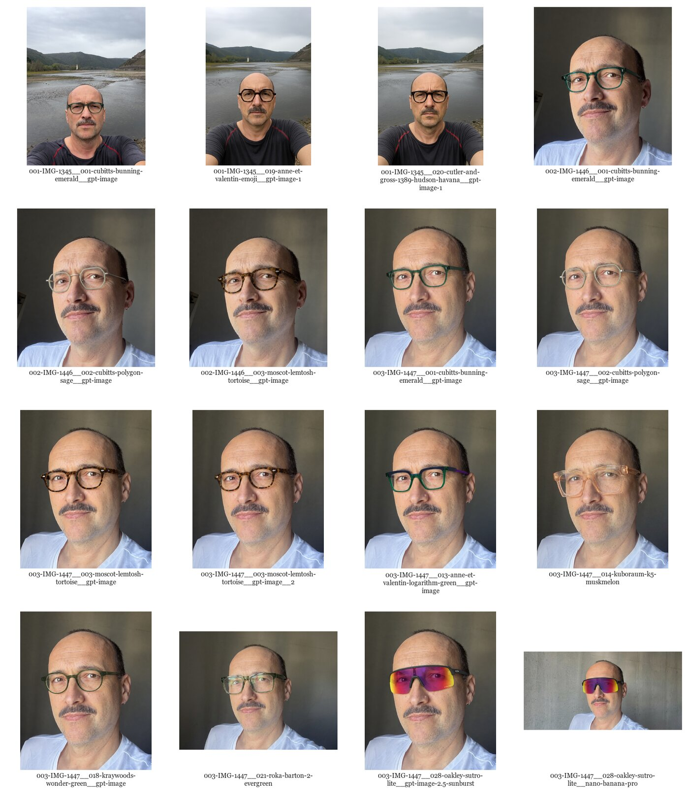

# style

`style` helps you find an eyeglass style that matches your personality and the look you want, then explore frames that bring that style to life.

## Setup

```sh
mise install
just sync
just lint
```

## Try-on examples



Each file is named `<face>__<frame>__<model>.png`.

## Setting up AI providers

Image generation goes through the project CLI (`style try-on`), which is also what Codex and
ChatGPT agents run. Set the environment variables for one provider before generating. The
first variable set wins, in this order:

| Provider   | Environment                              | Model                                             |
| ---------- | ---------------------------------------- | ------------------------------------------------- |
| OpenRouter | `OPENROUTER_API_KEY`, `OPENROUTER_MODEL` | `OPENROUTER_MODEL`, default `openai/gpt-image-1`  |
| Gemini     | `GEMINI_API_KEY`                         | `gemini-nano-banana-2.1` (fixed)                  |
| OpenAI     | `OPENAI_API_KEY`                         | `gpt-image-1` (fixed; used when no other key set) |

Example:

```sh
export OPENROUTER_API_KEY="..."
export OPENROUTER_MODEL="..."
```

Only OpenRouter lets you change the model through the environment. Keep API keys in your
local environment or secret manager, not in prompts or committed files. A failed generation
prints the provider error and exits with status 1.

### Choosing an image generation model

For the best results use **GPT Image 2.5 Sunburst** or **Nano Banana Pro**. Both keep the
face, lighting and background intact while swapping only the glasses. To select one, use the
OpenRouter provider and set `OPENROUTER_MODEL` to the model's OpenRouter slug. The direct
Gemini and OpenAI providers use the fixed defaults in the table above.

```sh
# GPT Image 2.5 Sunburst
export OPENROUTER_MODEL="openai/gpt-image-2.5-sunburst"

# Nano Banana Pro
export OPENROUTER_MODEL="google/gemini-3-pro-image"
```

## Using from the command line

`try-on` sends a face photo and a frame image to an image-generation API and saves the result to `resources/try-ons/<face>__<frame>.png`. Configure a provider first, see [Setting up AI providers](#setting-up-ai-providers).

```sh
uv run style try-on resources/faces/003-IMG-1447.jpeg resources/frames/002-cubitts-polygon-sage.jpg
```

## Using with Codex

Open this repository as the workspace in Codex. Codex reads the project guidance from
`AGENTS.md`, which points to `docs/ai-instructions.md`, and can use the project skills in
`.agents/skills/` for repeatable workflows.

Configure a provider in the environment available to Codex, see
[Setting up AI providers](#setting-up-ai-providers).

### From an exact frame

Ask Codex to use the `glasses-try-on` skill. Name a style skill such as `urban-mountaineer`
or `botan-pidor`, and specify the face photo and frame reference to use:

> Use the glasses-try-on skill with the urban-mountaineer style. Use
> `resources/faces/003-IMG-1447.jpeg` and
> `resources/frames/028-oakley-sutro-lite.png`. Generate one try-on.

Codex can also run the CLI directly when you already know which images to use:

```sh
uv run style try-on resources/faces/003-IMG-1447.jpeg resources/frames/028-oakley-sutro-lite.png
```

### From a style

Ask Codex to use the same skill and name the style and face photo. The skill workflow
searches for real frames, saves the chosen reference in `resources/frames/`, records its
source in `resources/frames/SOURCES.md`, and then generates the try-on:

> Use the glasses-try-on skill with the urban-mountaineer style. Use
> `resources/faces/003-IMG-1447.jpeg`. Find a real frame online that fits the style and
> my face, save its reference and source, then generate one try-on.

### Output

Codex follows the skill workflow, including saving the result under `resources/try-ons/`.

## Using in the ChatGPT app

Start a new chat with an image-capable model, picking the best one per
[Choosing an image generation model](#choosing-an-image-generation-model), and attach a face
photo (e.g. `resources/faces/003-IMG-1447.jpeg`) first. If ChatGPT runs the CLI for you, set
up a provider as described in [Setting up AI providers](#setting-up-ai-providers).

Add the skills from `.agents/skills/` (`glasses-try-on` plus the style skills `botan-pidor`,
`tech-bro`, `influencer`, `urban-mountaineer`, `gentrified-district-dweller`) to ChatGPT as
skills; they are standard `SKILL.md` folders.

### From an exact frame

Attach a frame image (e.g. `resources/frames/002-cubitts-polygon-sage.jpg`) second and send:

> The first image is a face photo, the second is a glasses frame. Use the glasses-try-on
> skill. Put that exact frame on the person in the first image, fitted to their face and
> head angle. Keep identity, facial features, facial hair, expression, lighting, background
> and crop unchanged. Change only the glasses; add no other accessories and do not retouch
> the face.

### From a style

Name a style skill and let ChatGPT find the frame. Optionally attach frame images from
`resources/frames/` as references. Send:

> The image is a face photo. Use the glasses-try-on skill with the botan-pidor style. Choose
> a real, specific glasses frame that fits this style and the person's face shape, and name
> the maker and model. If frame images are attached, use them as references for the
> direction rather than copying one exactly.

Swap `botan-pidor` for another style skill, or describe the look in your own words. Ask for
two or three variants in one reply to compare directions.

### Output

Save each result into `resources/try-ons/` as `<face>__<frame>.png`; for a style-driven
result, use the chosen model name as `<frame>`.
